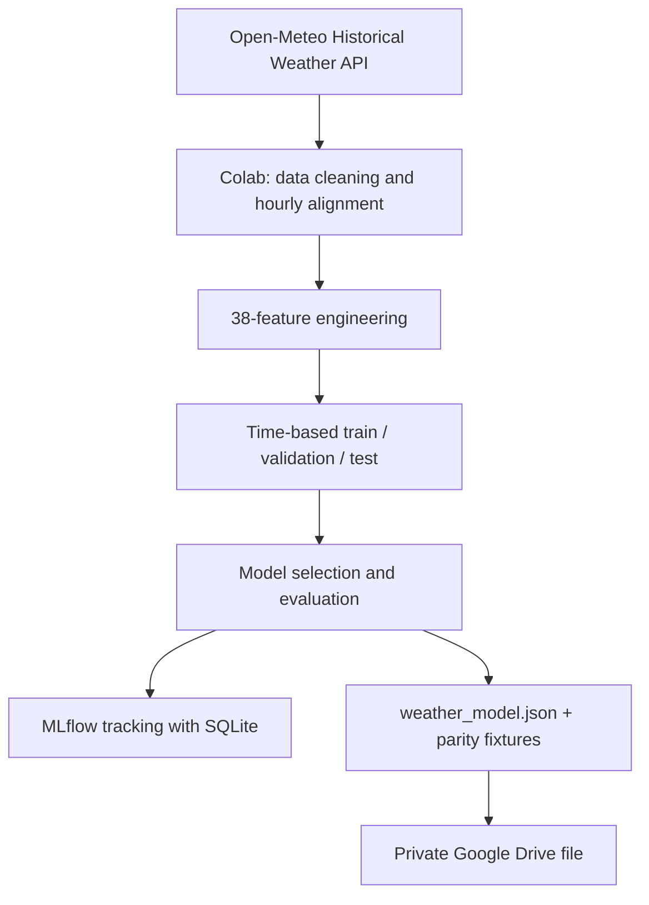
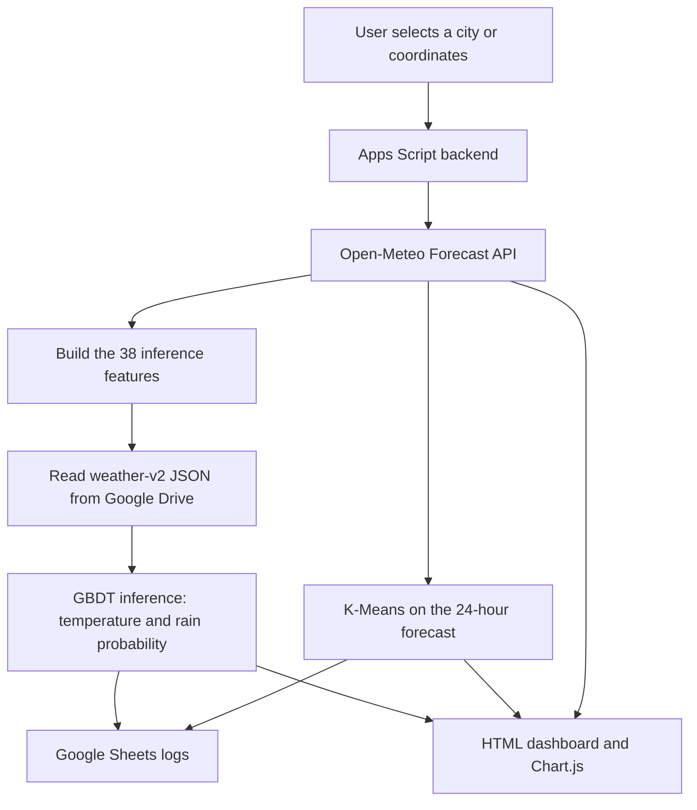

 <div align="center">

# 🌦️ Weather x Intelligence Dashboard

**Real-Time Weather Forecasting · Gradient Boosting · K-Means Clustering · Model Evaluation**

A weather dashboard built with **Google Apps Script**, **Google Sheets**, **Open-Meteo**, and a Python ML pipeline in **Google Colab**.

[Features](#-features) · [Architecture](#-architecture) · [Model Results](#-latest-model-evaluation) · [Installation](#-installation) · [Limitations](#-limitations-and-notes)

</div>

---

## 📌 Overview

Weather Intelligence Dashboard is a web application for exploring current weather conditions and hourly forecasts for a selected city or coordinate. It combines Open-Meteo weather data with a locally evaluated machine-learning model and unsupervised clustering to make forecast patterns easier to inspect.

The project separates model development from the deployed application:

- **Google Colab + Python** downloads historical weather data, engineers features, trains and evaluates models, and records experiments with MLflow.
- **Google Apps Script** retrieves weather data, builds inference features, runs the exported model, performs K-Means clustering, and writes logs to Google Sheets.
- **Google Sheets** stores weather snapshots, prediction logs, and experiment notes.
- **HTML/CSS/JavaScript + Chart.js** renders the dashboard in a browser.

The research location used for the current `weather-v2` model is **Surabaya, East Java, Indonesia** (approximately `-7.2575, 112.7521`).

## ✨ Features

### Weather and forecast

- Search by city name or enter latitude and longitude.
- Show current temperature, apparent temperature, humidity, precipitation, wind speed, and pressure.
- Display hourly forecast trends for the next 24 hours.
- Compare model predictions with Open-Meteo forecasts for **+1, +3, +6, and +24 hours**.

### Machine learning

- Predict target-hour temperature using a model trained to estimate temperature change:

  \[
  \hat{T}_{t+h} = T_t + \widehat{\Delta T}_{t+h}
  \]

- Estimate the probability that precipitation at the target hour is at least **0.1 mm**. This is the probability for the target hour, not cumulative probability over the entire forecast horizon.
- Export the trained `weather-v2` model to JSON for inference in Apps Script.
- Validate model schema and compare JavaScript outputs with Python parity fixtures.

### Unsupervised learning: K-Means

- Group the 24 hourly forecast points into **three clusters**.
- Clustering features include temperature, humidity, precipitation probability, wind speed, and cloud cover.
- Summarize each cluster with its number of hours and average weather characteristics.
- Cluster descriptions are short interpretations of the current forecast patterns, not official weather warnings.

### Evaluation and experiment tracking

- Evaluate stored predictions against historical Open-Meteo archive data.
- Report temperature absolute error and Brier score for rain probabilities when reference data becomes available.
- Export holdout-test metrics to `test_metrics.csv`.
- Track model parameters and experiments with MLflow using SQLite in the Colab environment.

### Data logging

- `WeatherLog`: weather snapshots.
- `PredictionLog`: predictions, target times, source labels, model versions, and historical evaluation fields.
- `ML_Model`: legacy/small-model storage or a note that the active v2 model is in Drive.
- `ExperimentNotes`: optional experiment records.
- `TestMetrics`: optional spreadsheet tab for a copy of `test_metrics.csv`; it is not required by the live inference code.

## 🧱 Architecture

### Training and model export



### Deployed dashboard



## 🧰 Technology Stack

| Component | Technology |
|---|---|
| Frontend | HTML, CSS, JavaScript, Chart.js |
| Backend and deployment | Google Apps Script Web App |
| Operational data store | Google Sheets |
| Weather data | Open-Meteo Forecast API and Historical Weather API |
| Model training | Python, pandas, NumPy, scikit-learn, Google Colab |
| Model tracking | MLflow with SQLite |
| Supervised model | Gradient boosting models exported as JSON for JavaScript inference |
| Unsupervised model | K-Means, currently `K = 3` on 24 hourly forecast points |

## 📊 Latest Model Evaluation

The following figures are from the latest `test_metrics.csv` shared for the `weather-v2` run. They are the reported holdout-test results, not a guarantee of future operational accuracy.

| Horizon | Temperature MAE (°C) ↓ | Temperature RMSE (°C) ↓ | Rain Brier Score ↓ | Rain ROC-AUC ↑ | Rain PR-AUC ↑ |
|---:|---:|---:|---:|---:|---:|
| 1 hour | 0.353 | 0.528 | 0.103 | 0.912 | 0.791 |
| 3 hours | 0.621 | 0.827 | 0.142 | 0.835 | 0.639 |
| 6 hours | 0.722 | 0.950 | 0.151 | 0.805 | 0.602 |
| 24 hours | 0.724 | 0.983 | 0.155 | 0.790 | 0.579 |

Additional reported checks:

- Temperature MAE skill versus persistence: about **40.8%**, **57.2%**, **70.3%**, and **8.5%** for +1, +3, +6, and +24 hours, respectively.
- Brier skill versus the climatology baseline is positive across the four horizons in this run.
- The reported test-set rain base rate is approximately **27.2%**.

Lower MAE, RMSE, and Brier Score are generally better. Higher ROC-AUC and PR-AUC are generally better. The rain probability threshold used for classification is selected on validation data; it should not be tuned repeatedly against the final test set.

**Reproducibility note:** results can change when the data period, selected models, library versions, or training configuration changes. Keep the notebook, model JSON, metrics CSV, and MLflow artifacts associated with the same run.

## 🚀 Installation

### 1. Create a Google Spreadsheet

1. Create a spreadsheet, for example `Weather Intelligence Database`.
2. Open **Extensions → Apps Script** from that spreadsheet so the script is bound to the spreadsheet.
3. Replace the contents of `Code.gs` with this repository's `Code.gs`.
4. Create an HTML file named **`Index`** and paste the contents of `Index.html` into it.
5. Save the project.

### 2. Initialize the spreadsheet

1. Select `setupProject()` from the Apps Script function dropdown.
2. Click **Run** and authorize the requested access.
3. Confirm that `WeatherLog`, `PredictionLog`, `ML_Model`, and `ExperimentNotes` exist.
4. Do not rename columns or reorder the header rows used by the backend.

### 3. Train or export the `weather-v2` model

1. Open the current **v2** `WeatherML_Colab.ipynb` in Google Colab.
2. Confirm the study coordinates and date range. The current model uses Surabaya coordinates and a historical period ending with a data-availability buffer.
3. Run the notebook cells in order to download historical data, engineer features, split data chronologically, select models using validation data, evaluate the test set, and log the experiments with MLflow.
4. Export `weather_model.json`, `test_metrics.csv`, and the MLflow artifacts.
5. Confirm that the model JSON uses `schema_version: 2`, has 38 features, and includes parity fixtures with `history`, `features`, and `expected` fields.

> **Important:** use the current v2 notebook that exports the 38-feature GBDT model. An older `weather-linear-v1` notebook with 24 features is not compatible with the `weather-v2` feature contract and must not be mistaken for the final training notebook.

### 4. Store the model JSON in Google Drive

The model JSON is approximately 0.87 MB in the reported run and is too large for a single Google Sheets cell. Store it as a private file in Google Drive instead.

1. Upload `weather_model.json` to Google Drive.
2. Keep its access set to **Restricted**. The Apps Script project must run with an account that has permission to read it.
3. Copy the file ID from its Drive URL.
4. In Apps Script, open **Project Settings → Script Properties**.
5. Add the property:

   | Property | Value |
   |---|---|
   | `WEATHER_MODEL_FILE_ID` | The Google Drive file ID for the current `weather_model.json` |

`setupProject()` stores the bound spreadsheet ID as `WEATHER_SPREADSHEET_ID`. Do not place secrets in `Index.html` or commit them to GitHub.

### 5. Validate model and inference

Run these functions from the Apps Script editor in this order:

1. `validateInstalledWeatherModel()` — checks the model file, schema, feature order, and tree structure.
2. `validateWeatherV2ParityFixture()` — compares feature engineering and predictions in Apps Script with the Python fixture.
3. `testLiveGbdtSurabaya()` — makes a live Open-Meteo request for Surabaya and verifies that all four horizons use `weather-v2` rather than the Open-Meteo fallback.

Do not switch production deployment to the new model until parity tests pass. Keep an earlier deployment or a copy of the spreadsheet available for rollback.

### 6. Deploy the web app

1. In Apps Script, choose **Deploy → New deployment → Web app**.
2. For initial testing, choose **Execute as: Me** and restrict access to **Only myself**.
3. Deploy and open the Web App URL.
4. Search for Surabaya or enter coordinates `-7.2575`, `112.7521`.
5. Confirm that the prediction table reports `ML lokal (weather-v2)` for horizons +1, +3, +6, and +24 hours.
6. When code changes later, choose **Deploy → Manage deployments → Edit → New version → Deploy**.

The `WEATHER_API_TOKEN` Script Property is only needed when using the optional protected `doPost` JSON endpoint. Keep this token private and do not embed it in browser JavaScript.

## 🧪 Testing Checklist

- [ ] `setupProject()` completes without changing existing log headers.
- [ ] `validateInstalledWeatherModel()` passes for the deployed JSON.
- [ ] `validateWeatherV2ParityFixture()` passes for features, temperature, and rain probabilities.
- [ ] `testLiveGbdtSurabaya()` confirms that all four horizons use `weather-v2`.
- [ ] `PredictionLog` stores horizon, target time, prediction source, and model version.
- [ ] K-Means returns cluster assignments for the 24-hour forecast.
- [ ] The dashboard labels model predictions separately from Open-Meteo forecasts.
- [ ] Historical evaluation only runs once the reference data for the target time is available.

## ⚠️ Keep the notebook and deployed model in sync

Before publishing the repository, verify that `WeatherML_Colab.ipynb` is the same **v2 notebook** used to export the deployed `weather-v2` model. The earlier starter notebook may still contain the legacy `weather-linear-v1` pipeline with 24 features, which is incompatible with the current 38-feature GBDT runtime. The notebook committed to GitHub should export `schema_version: 2`, `model_version: weather-v2`, 38 `feature_names`, GBDT trees for every target/horizon, and parity fixtures containing `history`, `features`, and `expected`. Do not present the legacy notebook as the current training pipeline.

## 📁 Suggested Repository Structure

```text
weather-intelligence-dashboard/
├── Code.gs
├── Index.html
├── WeatherML_Colab.ipynb       # Keep the current v2 notebook here
├── README.md
├── artifacts/                  # Optional: versioned model/evaluation outputs
│   ├── weather_model.json      # Optional; no secrets should be stored here
│   └── test_metrics.csv
└── .gitignore
```

Do not commit `mlflow.db` or the entire `mlartifacts/` directory unless you explicitly want to publish the experiment history and have checked the contents. Do not commit API tokens, credentials, personal spreadsheets, or other private data.

## ⚠️ Limitations and Notes

- **API terms and attribution:** Open-Meteo describes its public forecast API as free for open-source and non-commercial use, subject to terms and usage limits. Check the current terms before commercial use. Credit Open-Meteo near displayed data and link to the applicable license.
- **Data meaning:** current/forecast API values are weather-model products and are not guaranteed to be direct observations from a local station.
- **Historical reference:** the Historical Weather API provides ERA5/ERA5-Land reanalysis. These are historical reanalysis products, not guaranteed direct station measurements, and may have a publication delay. Dashboard evaluation should be described as a comparison against historical reanalysis.
- **Training/inference differences:** the model is trained from historical reanalysis. Live inference builds features from the forecast API response. This source difference may affect performance and should be monitored using stored predictions and reference data.
- **Location scope:** the current `weather-v2` model was trained for one location in Surabaya. Performance in other cities or geographic conditions has not been established by the reported results.
- **Clustering:** K-Means is recalculated from the current 24-hour forecast. Cluster IDs are relative to that run; cluster 1 today is not guaranteed to represent the same pattern tomorrow.
- **Usage and quotas:** Google Apps Script and Google Sheets have execution and request quotas. Cache repeated requests and avoid excessive polling.
- **Not an official warning system:** this is an experimental dashboard and should not be used as the sole source for safety-critical weather decisions.

## 🔗 References

- [Open-Meteo Forecast API](https://open-meteo.com/en/docs)
- [Open-Meteo Geocoding API](https://open-meteo.com/en/docs/geocoding-api)
- [Open-Meteo Historical Weather API](https://open-meteo.com/en/docs/historical-weather-api)
- [Open-Meteo Terms](https://open-meteo.com/en/terms)
- [Open-Meteo data license and attribution](https://github.com/open-meteo/open-meteo#data-license)
- [Google Apps Script HTML Service](https://developers.google.com/apps-script/guides/html)
- [Google Apps Script Web Apps](https://developers.google.com/apps-script/guides/web)
- [Google Apps Script quotas](https://developers.google.com/apps-script/guides/services/quotas)
- [MLflow local database tracking](https://mlflow.org/docs/latest/ml/tracking/tutorials/local-database)

---

<div align="center">

**Built as an end-to-end weather ML project:** historical data → training and evaluation → JSON export → JavaScript parity test → Apps Script inference → dashboard monitoring.

</div>
