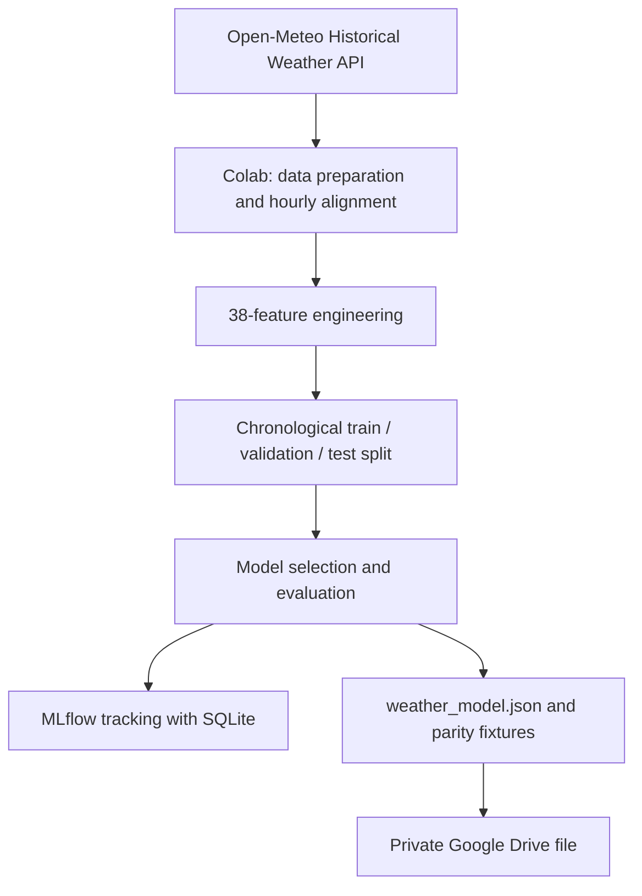
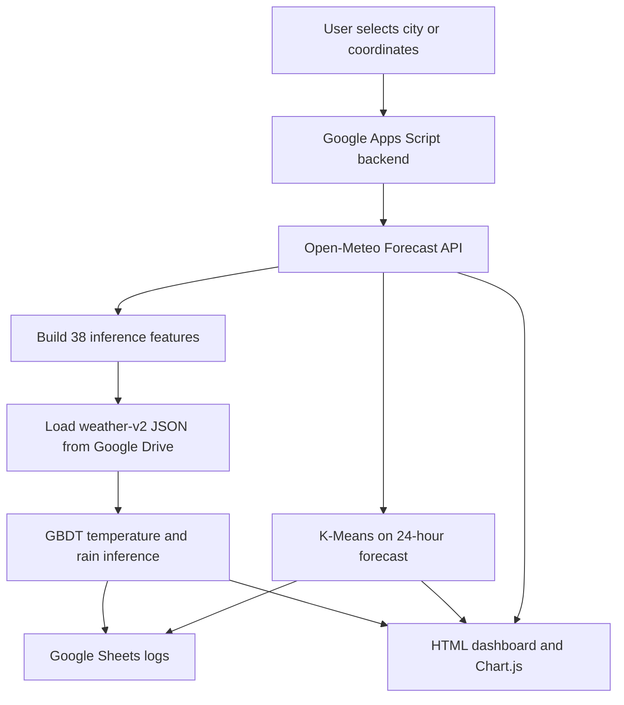

# 🌦️ Weather Intelligence Dashboard

### Weather Forecasting · Machine Learning · AQI Insights

A weather dashboard powered by **Google Apps Script**, **Google Sheets**, **Open-Meteo**, and a Python machine-learning pipeline developed in **Google Colab**.

 

[Overview](#-overview) · [Features](#-features) · [Architecture](#-architecture) · [Model Results](#-model-evaluation) · [Setup](#-setup-and-deployment) · [Limitations](#-limitations)

<!-- Replace GITHUB_ISSUE_IMAGE_URL with the image URL generated after uploading the banner to a GitHub Issue. -->

  

---

## 📌 Overview
**Weather Intelligence Dashboard** is a web application for exploring current weather conditions, hourly forecasts, machine-learning predictions, and air-quality information for a selected city or coordinate. It combines Open-Meteo weather and air-quality data with a locally evaluated **Gradient Boosting** model and **K-Means clustering** to make forecast patterns easier to inspect.

The current `weather-v2` model was developed for **Surabaya, East Java, Indonesia** (approximately `-7.2575, 112.7521`). Results for other locations have not been established.

### Live demo

Open the deployed dashboard here:

> The button opens the deployed web app in your browser. GitHub README cannot embed the interactive app directly; a screenshot can be added separately for a static preview.

## ✨ Features
| Area | Features |
|---|---|
| **Current weather** | Temperature, feels-like temperature, humidity, precipitation, wind speed, and pressure. |
| **Air quality (AQI)** | Air-quality indicators such as US AQI, European AQI, PM2.5, PM10, ozone, and UV index when returned by the API. |
| **Hourly forecast** | Explore weather trends across the next 24 hours. |
| **ML predictions** | Estimate temperature and rain probability for **+1, +3, +6, and +24 hours**. |
| **Forecast comparison** | Compare model predictions with the Open-Meteo forecast baseline. |
| **K-Means clustering** | Group the 24 hourly forecast points into three weather-pattern clusters. |
| **Historical evaluation** | Track temperature absolute error and rain-probability Brier score when historical reference data becomes available. |
| **Experiment tracking** | Record model experiments with MLflow and SQLite in the Colab environment. |
| **Data logging** | Store weather snapshots, predictions, model versions, and evaluation results in Google Sheets. |

### Prediction targets
- **Temperature:** the model predicts a temperature change, which is added to the current temperature: `T(t+h) = T(t) + predicted_delta`.
- **Rain probability:** estimates the probability that precipitation at the target hour is at least **0.1 mm**. It is not the cumulative probability of rain over the full forecast horizon.

K-Means cluster descriptions are interpretations of the current forecast pattern, not official weather warnings. Cluster IDs can change between runs.

## 🧱 Architecture
### Model training and export

### Live dashboard flow

## 🛠️ Technology stack
| Component | Technology |
|---|---|
| Frontend | HTML, CSS, JavaScript, Chart.js |
| Backend and deployment | Google Apps Script Web App |
| Storage and logging | Google Sheets |
| Weather data | Open-Meteo Forecast API and Historical Weather API |
| Model development | Python, pandas, NumPy, scikit-learn, Google Colab |
| Model tracking | MLflow with SQLite |
| Supervised model | Gradient Boosting models exported to JSON for JavaScript inference |
| Unsupervised analysis | K-Means clustering (`K = 3`) on 24 hourly forecast points |

## 📊 Model evaluation
The table below summarizes the reported holdout-test results for `weather-v2`. These are experimental results, not a guarantee of future operational accuracy.

| Forecast horizon | Temperature MAE ↓ (°C) | Temperature RMSE ↓ (°C) | Rain Brier score ↓ | Rain ROC-AUC ↑ | Rain PR-AUC ↑ |
|---:|---:|---:|---:|---:|---:|
| **+1 hour** | 0.353 | 0.528 | 0.103 | 0.912 | 0.791 |
| **+3 hours** | 0.621 | 0.827 | 0.142 | 0.835 | 0.639 |
| **+6 hours** | 0.722 | 0.950 | 0.151 | 0.805 | 0.602 |
| **+24 hours** | 0.724 | 0.983 | 0.155 | 0.790 | 0.579 |

Additional reported checks:
- Temperature MAE skill versus persistence: approximately **40.8%**, **57.2%**, **70.3%**, and **8.5%** at +1, +3, +6, and +24 hours, respectively.
- Brier skill versus the climatology baseline was positive for all four horizons in this run.
- The test-set rain base rate was approximately **27.2%**.

Lower MAE, RMSE, and Brier score are generally better; higher ROC-AUC and PR-AUC are generally better. Select the rain-probability classification threshold using validation data, not by repeatedly tuning against the final test set.

**Reproducibility:** metrics can change with the data period, selected model, library versions, or training configuration. Keep the notebook, exported model JSON, metrics CSV, and MLflow artifacts associated with the same training run.

## ⚠️ Limitations
- **Weather data:** current and forecast API values are weather-model products and are not guaranteed to be direct observations from a local station.
- **Historical reference:** evaluation uses Open-Meteo historical reanalysis (ERA5/ERA5-Land), not guaranteed station measurements. Historical data may be delayed.
- **Training/inference source difference:** training uses historical reanalysis, while live inference constructs features from the forecast API response. This difference can affect predictive performance.
- **Geographic scope:** the current `weather-v2` model was trained for Surabaya. Performance in other cities has not been established.
- **Clustering:** K-Means is recomputed from the current forecast; cluster IDs do not carry a fixed meaning across runs.
- **Usage limits:** Google Apps Script, Google Sheets, and public API services have quotas or usage limits. Avoid excessive polling and check provider terms before commercial use.
- **Safety:** this experimental dashboard is not an official weather-warning system and should not be used as the sole source for safety-critical decisions.

## 🔗 References
- [Open-Meteo Forecast API](https://open-meteo.com/en/docs)
- [Open-Meteo Geocoding API](https://open-meteo.com/en/docs/geocoding-api)
- [Open-Meteo Historical Weather API](https://open-meteo.com/en/docs/historical-weather-api)
- [Open-Meteo Terms](https://open-meteo.com/en/terms)
- [Open-Meteo data license and attribution](https://github.com/open-meteo/open-meteo#data-license)
- [Google Apps Script HTML Service](https://developers.google.com/apps-script/guides/html)
- [Google Apps Script Web Apps](https://developers.google.com/apps-script/guides/web)
- [Google Apps Script quotas](https://developers.google.com/apps-script/guides/services/quotas)
- [MLflow local database tracking](https://mlflow.org/docs/latest/ml/tracking/tutorials/local-database)

---

**Built by [adepanjaitan23](https://github.com/adepanjaitan23)**

*Historical data → model training and evaluation → JSON export → parity testing → Apps Script inference → dashboard monitoring*

