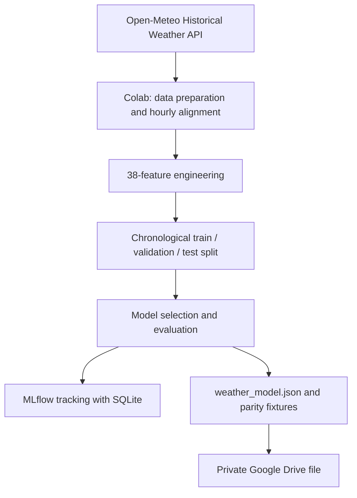
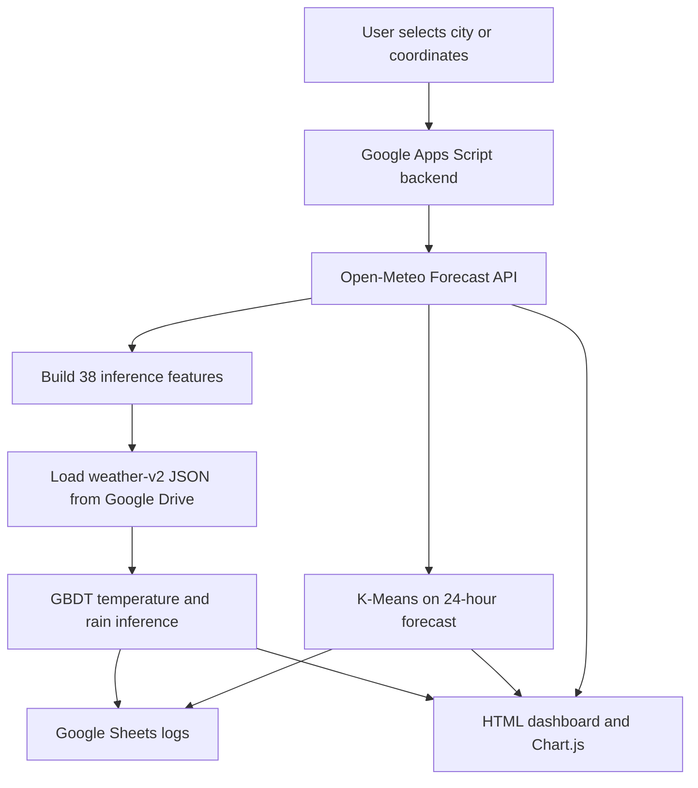

<div align="center">

# 🌦️ Weather Intelligence Dashboard

### Real-Time Forecasting · Machine Learning · Weather Pattern Analysis

A weather dashboard powered by **Google Apps Script**, **Google Sheets**, **Open-Meteo**, and a Python machine-learning pipeline developed in **Google Colab**.

[](https://script.google.com/macros/s/AKfycbyJA6grCm47XUp_tQ3tCCjSmTuSNRfoYzdlvb4KLMlnS8qj5bCPM0RiguX5k4eYG3zJ/exec)<br>
[](https://developers.google.com/apps-script)
[](https://www.python.org/)
[](https://open-meteo.com/)

[Overview](#-overview) · [Features](#-features) · [Architecture](#-architecture) · [Model Results](#-model-evaluation) · [Setup](#-setup-and-deployment) · [Limitations](#-limitations)

</div>

---

## 📌 Overview

**Weather Intelligence Dashboard** is a web application for exploring current weather conditions, hourly forecasts, and machine-learning predictions for a selected city or coordinate. It combines Open-Meteo weather data with a locally evaluated **Gradient Boosting** model and **K-Means clustering** to make forecast patterns easier to inspect.

The current `weather-v2` model was developed for **Surabaya, East Java, Indonesia** (approximately `-7.2575, 112.7521`). Results for other locations have not been established.

### Live demo

Open the deployed dashboard here:

[](https://script.google.com/macros/s/AKfycbyJA6grCm47XUp_tQ3tCCjSmTuSNRfoYzdlvb4KLMlnS8qj5bCPM0RiguX5k4eYG3zJ/exec)

> GitHub README cannot embed an interactive external web app directly. Use the live demo link to open the application. Add a genuine dashboard screenshot to the repository if you want a static image preview here.

## ✨ Features

| Area | Features |
|---|---|
| **Current weather** | Temperature, feels-like temperature, humidity, precipitation, wind speed, and pressure. |
| **Hourly forecast** | Explore weather trends across the next 24 hours. |
| **ML predictions** | Estimate temperature and rain probability for **+1, +3, +6, and +24 hours**. |
| **Forecast comparison** | Compare model predictions with the Open-Meteo forecast baseline. |
| **K-Means clustering** | Group the 24 hourly forecast points into three weather-pattern clusters. |
| **Historical evaluation** | Track temperature absolute error and rain-probability Brier score when historical reference data becomes available. |
| **Experiment tracking** | Record model experiments with MLflow and SQLite in the Colab environment. |
| **Data logging** | Store weather snapshots, predictions, model versions, and evaluation results in Google Sheets. |

### Prediction targets

- **Temperature:** the model predicts a temperature change, which is added to the current temperature: `T(t+h) = T(t) + predicted_delta`.
- **Rain probability:** estimates the probability that precipitation at the target hour is at least **0.1 mm**. It is not the cumulative probability of rain over the full forecast horizon.

K-Means cluster descriptions are interpretations of the current forecast pattern, not official weather warnings. Cluster IDs can change between runs.

## 🧱 Architecture

### Model training and export



### Live dashboard flow



## 🛠️ Technology stack

| Component | Technology |
|---|---|
| Frontend | HTML, CSS, JavaScript, Chart.js |
| Backend and deployment | Google Apps Script Web App |
| Storage and logging | Google Sheets |
| Weather data | Open-Meteo Forecast API and Historical Weather API |
| Model development | Python, pandas, NumPy, scikit-learn, Google Colab |
| Model tracking | MLflow with SQLite |
| Supervised model | Gradient Boosting models exported to JSON for JavaScript inference |
| Unsupervised analysis | K-Means clustering (`K = 3`) on 24 hourly forecast points |

## 📊 Model evaluation

The table below summarizes the reported holdout-test results for `weather-v2`. These are experimental results, not a guarantee of future operational accuracy.

| Forecast horizon | Temperature MAE ↓ (°C) | Temperature RMSE ↓ (°C) | Rain Brier score ↓ | Rain ROC-AUC ↑ | Rain PR-AUC ↑ |
|---:|---:|---:|---:|---:|---:|
| **+1 hour** | 0.353 | 0.528 | 0.103 | 0.912 | 0.791 |
| **+3 hours** | 0.621 | 0.827 | 0.142 | 0.835 | 0.639 |
| **+6 hours** | 0.722 | 0.950 | 0.151 | 0.805 | 0.602 |
| **+24 hours** | 0.724 | 0.983 | 0.155 | 0.790 | 0.579 |

Additional reported checks:

- Temperature MAE skill versus persistence: approximately **40.8%**, **57.2%**, **70.3%**, and **8.5%** at +1, +3, +6, and +24 hours, respectively.
- Brier skill versus the climatology baseline was positive for all four horizons in this run.
- The test-set rain base rate was approximately **27.2%**.

Lower MAE, RMSE, and Brier score are generally better; higher ROC-AUC and PR-AUC are generally better. Select the rain-probability classification threshold using validation data, not by repeatedly tuning against the final test set.

**Reproducibility:** metrics can change with the data period, selected model, library versions, or training configuration. Keep the notebook, exported model JSON, metrics CSV, and MLflow artifacts associated with the same training run.

## 🚀 Setup and deployment

### Prerequisites

- A Google account with access to Google Sheets, Google Drive, and Google Apps Script.
- The current **v2** `WeatherML_Colab.ipynb` notebook and its exported `weather_model.json`.
- The project files `Code.gs` and `Index.html`.

### 1. Create and initialize the spreadsheet

1. Create a Google Spreadsheet, for example `Weather Intelligence Database`.
2. Open **Extensions → Apps Script** so the script is bound to the spreadsheet.
3. Replace the contents of `Code.gs` with this repository's backend code.
4. Create an HTML file named **`Index`** and paste in the contents of `Index.html`.
5. Save, select `setupProject()` in the function dropdown, and click **Run**.
6. Authorize the requested permissions and confirm these sheets exist: `WeatherLog`, `PredictionLog`, `ML_Model`, and `ExperimentNotes`.

Do not rename the sheets' required columns or change the order of existing headers.

### 2. Install the trained model in Google Drive

The reported model JSON is about **0.87 MB**, so it should be stored as a Drive file rather than in a single Google Sheets cell.

1. Upload `weather_model.json` to Google Drive.
2. Keep the file set to **Restricted**; the Apps Script execution account must have permission to read it.
3. Copy the file ID from its Drive URL.
4. In Apps Script, open **Project Settings → Script Properties** and add:

   | Property | Value |
   |---|---|
   | `WEATHER_MODEL_FILE_ID` | The Drive file ID for `weather_model.json` |

`setupProject()` saves the bound spreadsheet ID as `WEATHER_SPREADSHEET_ID`. Do not put tokens, credentials, or private IDs in frontend code or publish secrets to GitHub.

### 3. Verify model compatibility

Run these functions from the Apps Script editor in order:

1. `validateInstalledWeatherModel()` — checks the model schema, feature order, and tree structure.
2. `validateWeatherV2ParityFixture()` — compares feature generation and predictions between Apps Script and Python fixtures.
3. `testLiveGbdtSurabaya()` — requests live weather data and verifies that all four horizons use `weather-v2` rather than the Open-Meteo fallback.

Deploy the updated model only after the validation checks pass. Keep an earlier deployment or a spreadsheet copy available for rollback.

### 4. Deploy the web app

1. Select **Deploy → New deployment → Web app**.
2. For initial testing, select **Execute as: Me** and restrict access to **Only myself**.
3. Click **Deploy**, authorize access if prompted, and open the Web App URL.
4. Search for Surabaya or enter the coordinates `-7.2575, 112.7521`.
5. Confirm that the prediction table reports `ML lokal (weather-v2)` for all four forecast horizons.
6. For later code changes, use **Deploy → Manage deployments → Edit → New version → Deploy**.

The `WEATHER_API_TOKEN` Script Property is only needed for the optional protected `doPost` JSON endpoint. Do not embed this token in browser-side JavaScript.

## ✅ Testing checklist

- [ ] `setupProject()` completes successfully.
- [ ] `validateInstalledWeatherModel()` passes for the installed JSON.
- [ ] `validateWeatherV2ParityFixture()` passes for features, temperature, and rain probability.
- [ ] `testLiveGbdtSurabaya()` confirms that all four horizons use `weather-v2`.
- [ ] `PredictionLog` stores forecast horizon, target time, source, and model version.
- [ ] K-Means generates cluster assignments for the 24-hour forecast.
- [ ] The dashboard distinguishes model predictions from Open-Meteo baseline forecasts.
- [ ] Historical evaluation runs only after the reference data becomes available.

## 📁 Repository structure

```text
weather-intelligence-dashboard/
├── Code.gs
├── Index.html
├── WeatherML_Colab.ipynb       # Must be the current v2 training notebook
├── README.md
├── artifacts/                  # Optional, versioned evaluation outputs
│   └── test_metrics.csv
└── .gitignore
```

Avoid committing `mlflow.db`, the full `mlartifacts/` directory, private spreadsheet data, API tokens, or credentials unless you have reviewed the contents and intentionally want to publish them. The model JSON is optional in the public repository; the deployed application reads the private Drive copy configured in Script Properties.

> **Notebook compatibility warning:** an older `weather-linear-v1` notebook with 24 features is not compatible with the current 38-feature `weather-v2` GBDT runtime. Before publishing, confirm that the committed notebook exports `schema_version: 2`, `model_version: weather-v2`, all 38 `feature_names`, GBDT trees for every target/horizon, and parity fixtures containing `history`, `features`, and `expected`.

## ⚠️ Limitations

- **Weather data:** current and forecast API values are weather-model products and are not guaranteed to be direct observations from a local station.
- **Historical reference:** evaluation uses Open-Meteo historical reanalysis (ERA5/ERA5-Land), not guaranteed station measurements. Historical data may be delayed.
- **Training/inference source difference:** training uses historical reanalysis, while live inference constructs features from the forecast API response. This difference can affect predictive performance.
- **Geographic scope:** the current `weather-v2` model was trained for Surabaya. Performance in other cities has not been established.
- **Clustering:** K-Means is recomputed from the current forecast; cluster IDs do not carry a fixed meaning across runs.
- **Usage limits:** Google Apps Script, Google Sheets, and public API services have quotas or usage limits. Avoid excessive polling and check provider terms before commercial use.
- **Safety:** this experimental dashboard is not an official weather-warning system and should not be used as the sole source for safety-critical decisions.

## 🔗 References

- [Open-Meteo Forecast API](https://open-meteo.com/en/docs)
- [Open-Meteo Geocoding API](https://open-meteo.com/en/docs/geocoding-api)
- [Open-Meteo Historical Weather API](https://open-meteo.com/en/docs/historical-weather-api)
- [Open-Meteo Terms](https://open-meteo.com/en/terms)
- [Open-Meteo data license and attribution](https://github.com/open-meteo/open-meteo#data-license)
- [Google Apps Script HTML Service](https://developers.google.com/apps-script/guides/html)
- [Google Apps Script Web Apps](https://developers.google.com/apps-script/guides/web)
- [Google Apps Script quotas](https://developers.google.com/apps-script/guides/services/quotas)
- [MLflow local database tracking](https://mlflow.org/docs/latest/ml/tracking/tutorials/local-database)

---

<div align="center">

*Historical data → model training and evaluation → JSON export → parity testing → Apps Script inference → dashboard monitoring*

</div>
